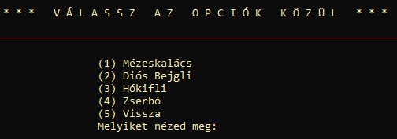
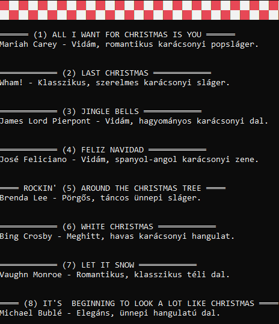
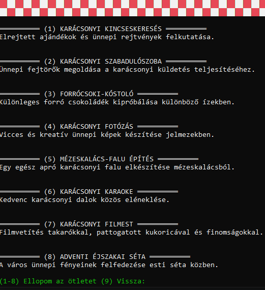

<h1 align="center">KarácsonyHUB 🎄</h1>

A **KarácsonyHUB** egy C# app amely segít a karácsonyi készülődéshez. A programban recepteket, karácsonyi zenéket és különböző ünnepi programokat lehet böngészni és elmenteni.

## A program működése

Az alkalmazás elindítása után a KarácsonyHUB főmenüje jelenik meg, ahol a felhasználó négy lehetőség közül választhat. Ezek közül a fel-le nyilakkal lehet navigálni, a kiválasztás pedig az "Enter"-el.

## Főbb funkciók

**🍪 Karácsonyi receptek**

Négy klasszikus karácsonyi sütemény receptje található meg az alkalmazásban:

A receptek kiválasztása útán tartalmazzák a szükséges hozzávalókat és az elkészítés lépéseit. A kiválasztott receptek elmenthetők.

**🎵 Karácsonyi zenék**

Nyolc ismert karácsonyi dal közül lehet választani.  Minden dalhoz tartozik egy rövid leírás, amely bemutatja annak hangulatát. A kiválasztott zenék a data.txt file-ba kerülnek.

 
 
 

**🎅 Karácsonyi programötletek**

Nyolc különböző ünnepi programötlet közül lehet válogatni, például karácsonyi kincskeresés, forrócsoki-kóstoló vagy mézeskalács-falu építés. A kiválasztott ötletek szintén elmenthetők.

 
 

## Adatok mentése

A programban kiválasztott receptek, zenék és programötletek külön listákban tárolódnak. Kilépéskor az alkalmazás ezeket egy `data.txt` nevű szövegfájlba menti, így a kiválasztott elemek egy helyen összegyűjtve megtekinthetők. 

 **Ne felejtsük, hogy ha nem a kilépés gombbal lépünk ki az appból akkor nem menti el az eddigi karácsonyi szépségeket!**

## Technikai információk

- **Programozási nyelv:** C#
- **Adattárolás:** Listák `List<string>` 
- **Fájlkezelés:** (`data.txt`)
- **Hibakezelés** (`try-catch`)

## **Köszönjük, hogy minket választott és *Boldog Karácsonyt* kíván a KarácsonyHub csapata: Knézi Alex és becses munkasa, Sándor Áron!**